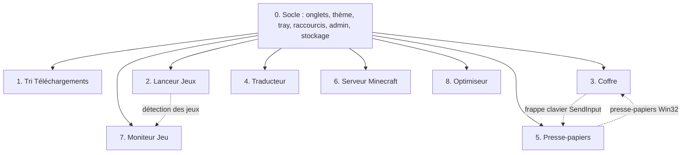

# OutilsRust : tous les outils réécrits en Rust, dans un seul programme

Un seul exe (`Outils.exe`), interface `egui` (eframe), un onglet par outil. Chaque outil garde ses
fichiers de données actuels (`%APPDATA%\...`, `regles.json`…) pour ne rien perdre au passage.
Les anciens outils restent en place tant que leur version Rust n'est pas terminée.

## Liste (ordre de réécriture : du plus simple au plus risqué)

| # | Outil | Origine | Lignes | Points durs en Rust |
|---|-------|---------|-------:|---------------------|
| 0 | Socle (hub) | Python | 330 | onglets, thème sombre, icône de notification, raccourcis globaux, une seule instance, droits admin à la demande |
| 1 | Tri Téléchargements | Python | 250 | surveillance du dossier (`notify`), `regles.json` |
| 2 | Lanceur Jeux | Python | 420 | lecture Steam/Epic, jaquettes (`image`), temps de jeu, `data.json` |
| 3 | Coffre Mots De Passe | Python | 980 | Argon2id + AES-256-GCM compatibles avec `coffre.json`, presse-papiers exclu de l'historique, frappe clavier (`SendInput`), verrou auto |
| 4 | Traducteur Sous Titres | Python | 950 | parseurs SRT/VTT/ASS, Google/DeepL (`ureq`), ffmpeg, glisser-déposer |
| 5 | Presse-papiers | C# | 990 | écoute `WM_CLIPBOARDUPDATE`, texte riche + images, popup `Ctrl+Maj+V`, recoller dans l'appli d'origine |
| 6 | Serveur Minecraft | Python | 1070 | processus Java + console, sauvegardes zip, modpacks (mrpack/CurseForge), playit, mode veille |
| 7 | Moniteur Jeu | C# | 1140 | capteurs CPU/GPU (NVML), FPS via ETW, overlay, mode jeu (admin) |
| 8 | Optimiseur Windows | PowerShell | 1250 | nettoyages, registre, services, désinstallation d'applis (admin) |

Hors liste : MiniJeuxBluetooth (Android) et StreetPoker (serveur web).

## Graphe

## Stack

- `eframe`/`egui` : interface ; `tray-icon` + `global-hotkey` : zone de notification et raccourcis
- `windows` (crate officielle) : Win32 (presse-papiers, SendInput, registre, services)
- `serde_json` : données ; `notify` : surveillance de dossiers ; `ureq` : HTTP ; `zip`, `image`
- `argon2` + `aes-gcm` : coffre
- Toolchain `stable-x86_64-pc-windows-gnu` (pas besoin de Visual Studio)
